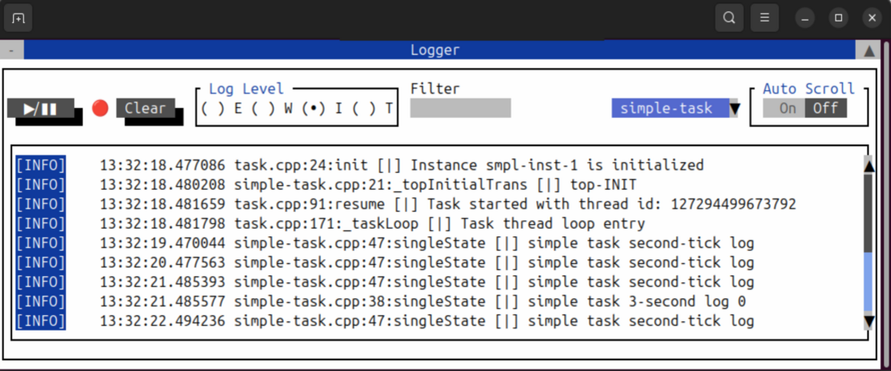

# state-machine-actor-framework
Divide and conquire your projects with encapsulated [actors](https://en.wikipedia.org/wiki/Actor_model) that are constructed as [hierarchical state machines](https://en.wikipedia.org/wiki/UML_state_machine)  
Unit-test friendly development as an actor being a full enclapsulated ultimate SUT for TDD

## Features
- Dynamic actor creation and related thread management
- Zero-copy event delivery system with thread safe event queue structures
- Timed event delivery
- Direct or publish-subscribe actor communication
- Unit-test utility methods for checking resulted state of actors after event process
- Optional system-wide state monitoring TUI (`-DuOS_ENABLE_TUI=ON`)
- File logging for every actor on its seperate file with rotation
- Optional CLI utility for event-injection or other test/trigger purposes (`-DuOS_ENABLE_CLI=ON`)

<br>



This framework is exceptionaly good as a project base for AI asisted/generated development;
- Code complete or agents easily understand the state transition pattern of individual tasks for tab-tab-tab programming
- Fully encapsulated actors present small pills of context for AI that prevents it to go astray

<br>

Inspired and based on 2008 book "Practical UML Statecharts in C/C++" by Miro Samek which is intended for embedded systems.   
This implementation of UML state-machine framework, however, is intended for high level server side applications and written in modern C++17

<br>

# Project Dependencies

TUI and CLI are off by default. Enable them at configure time:

```bash
cmake -S . -B build -DuOS_ENABLE_TUI=ON -DuOS_ENABLE_CLI=ON
```

## Always required

### Libraries
- pthread

### Tools
- CMake >3.15
- GIT
- pkg-config

## Linux only (crash backtraces)

Pretty stack traces on crash need a DWARF reader. Configure picks the first available, in this order:
- libdw-dev (preferred, from elfutils)
- binutils-dev (libbfd)
- libdwarf-dev (plus libelf)

If none of those are installed, configure fails and asks for libdw.

macOS uses `backtrace_symbols` instead and needs none of these packages.

## Only with `-DuOS_ENABLE_TUI=ON`

### Libraries
- libgpm-dev
- libncurses-dev

### Tools (needed when finalcut is built from source)
- libtool
- autoconf-archive

## Only with `-DuOS_ENABLE_CLI=ON`

### Libraries
- asio (standalone)
- nlohmann/json (fetched if not installed)
- cli (daniele77/cli, fetched if not installed)

rescue yourself from concurency/multi-threding hell with fully encapsulated actors
rescue yourself from convoluted logics, 50 tier elseif, numerous flags with UML state-machines 
this framework marries two best concepts of programming on OOP ground: the actor-model and hierarchical UML state-machines (which is essentialy OOP for finite state machines)